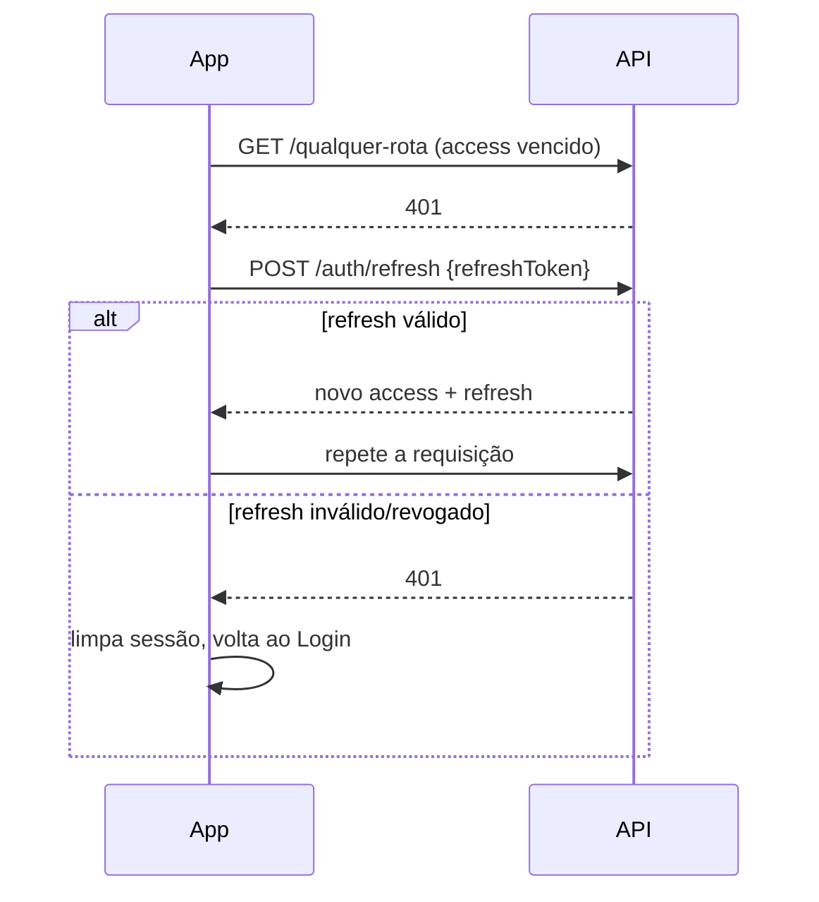
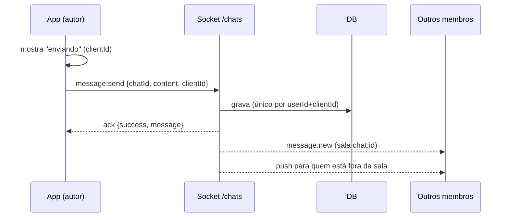
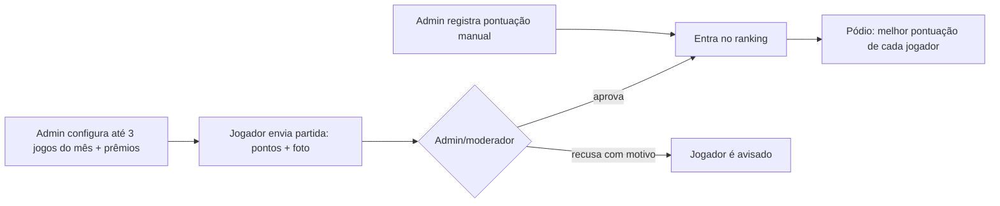
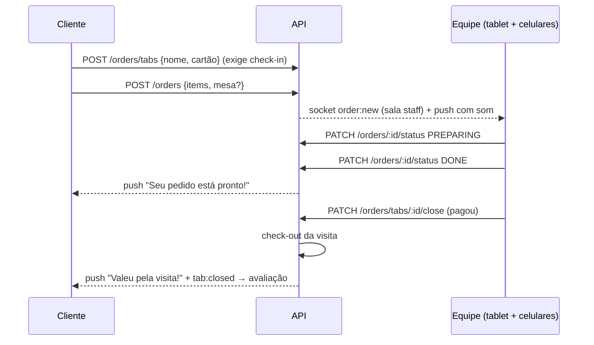

# MIPO: fluxos do aplicativo

Documento de referência para o dono, a equipe da loja e os desenvolvedores. Descreve o que o app faz hoje, tela por tela e endpoint por endpoint.

- **App:** `MIPO-App-Frontend` (Expo / React Native). As telas são citadas pelo **nome da rota** de navegação.
- **API:** `MIPO-App-Backend` (NestJS + TypeORM + Postgres). As rotas são relativas à URL base (ex.: `https://mipoappbackend-…b4a.run`).
- Toda rota exige login (`Authorization: Bearer <access token>`), exceto `/auth/*` públicas e `/legal/*`.

## Índice

1. [Glossário](#glossário)
2. [Papéis e permissões](#papéis-e-permissões)
3. [Cadastro, login e sessão](#1-cadastro-login-e-sessão)
4. [Gates de data de nascimento e termos](#2-gates-de-data-de-nascimento-e-termos)
5. [Perfil e configurações](#3-perfil-e-configurações)
6. [Amizades e bloqueio](#4-amizades-e-bloqueio)
7. [Feed social](#5-feed-social)
8. [Chat](#6-chat)
9. [Denúncias e moderação](#7-denúncias-e-moderação)
10. [Eventos](#8-eventos)
11. [Jogos e catálogo](#9-jogos-e-catálogo)
12. [Jogos do mês](#10-jogos-do-mês)
13. [Histórico de jogos e recomendações](#11-histórico-de-jogos-e-recomendações)
14. [Check-in na loja e presença](#12-check-in-na-loja-e-presença)
15. [Comanda, cardápio e pedidos](#13-comanda-cardápio-e-pedidos)
16. [Avaliação da visita e dos pedidos](#14-avaliação-da-visita-e-dos-pedidos)
17. [Procuro jogadores](#15-procuro-jogadores)
18. [Recompensas e moedas](#16-recompensas-e-moedas)
19. [Conquistas](#17-conquistas)
20. [Notificações](#18-notificações)
21. [Banner da Home](#19-banner-da-home)
22. [Painel admin](#20-painel-admin)
23. [Frequência e estatísticas](#21-frequência-e-estatísticas)
24. [Retenção de dados e crons](#22-retenção-de-dados-e-crons)
25. [Tabela de deep links](#tabela-de-deep-links)
26. [Tabela de eventos de socket](#tabela-de-eventos-de-socket)

---

## Glossário

| Termo | Significado |
|---|---|
| **Check-in** | Registro de que o jogador está **dentro da loja**. Feito lendo o QR da loja (ou pela equipe). Cria uma *visita* aberta. |
| **Visita** | Período entre check-in e check-out (`store_visits`). Só existe uma aberta por pessoa. |
| **Presença** | Lista "quem está na Mipo agora", formada pelas visitas abertas. Cada pessoa pode se ocultar. |
| **Comanda** | Conta aberta de uma pessoa durante a visita (`order_tabs`), identificada por **nome + número do cartão**. Reúne os pedidos. |
| **Cartão** | Cartãozinho numerado que a loja entrega na chegada, usado para cobrar no sistema da loja. Um cartão só pode estar em uma comanda aberta. |
| **Pedido** | Conjunto de itens enviado da comanda para a equipe: comida/bebida (cardápio), jogo para a mesa ou chamado de monitor. |
| **Chamado de monitor** | Pedido do tipo "ajuda com jogo" (item `HELP`), sem custo. A equipe vai até a mesa explicar regras. |
| **Procuro jogadores** | "Chamado" para montar mesa: "quero jogar X, faltam N". Pode ser **agora** (só quem está na loja) ou **agendado**. |
| **Jogos do mês** | Até 3 jogos definidos pelo admin por mês, com ranking por pontuação e prêmios para os 3 primeiros. |
| **Moedas** | Saldo virtual do jogador, dado pela loja/admin, trocado na loja de recompensas. Não envolve dinheiro no app. |
| **Equipe** | Usuários com papel `WAITER` (garçom) ou `ADMIN`. |

## Papéis e permissões

| Ação | USER | WAITER | MODERATOR | ADMIN |
|---|:-:|:-:|:-:|:-:|
| Usar o app (social, chat, eventos, pedidos, check-in) | ✓ | ✓ | ✓ | ✓ |
| Ver aba **Painel** | | ✓ | ✓ | ✓ |
| Tela de pedidos (`StaffOrders`), mudar status, fechar comanda | | ✓ | | ✓ |
| Check-in/check-out manual (`StaffCheckIn`) | | ✓ | | ✓ |
| Aprovar/recusar eventos e partidas dos jogos do mês | | | ✓ | ✓ |
| Denúncias: ver, descartar, remover post/mensagem, banir | | | ✓ | ✓ |
| Cardápio, QR da loja, frequência, avaliações | | | | ✓ |
| Usuários (papéis, ban, moedas), finanças, notificações em massa | | | | ✓ |
| Jogos, jogos do mês (configurar/registro manual), recompensas, conquistas | | | | ✓ |

O papel é verificado no backend a cada requisição (`JwtStrategy` relê o usuário; `RolesGuard` + `@Roles`). Só ADMIN troca papéis (`PATCH /users/:id/role`), e ninguém troca o próprio.

---

## 1. Cadastro, login e sessão

**Objetivo:** criar conta só para maiores de 18 anos, com aceite dos termos, e manter a sessão segura.

**Telas:** `Login` (abas entrar / cadastrar / recuperar senha).

**Passo a passo (usuário)**
1. Em **Cadastrar**, informa nome, e-mail ou telefone, senha e **data de nascimento** (seletor de data).
2. Marca o checkbox "Li e aceito os Termos de Uso e a Política de Privacidade" (links abrem as páginas `/legal/...`).
3. Toca em cadastrar e já entra logado.

**Backend**

| Método | Rota | Regras |
|---|---|---|
| POST | `/auth/register` | `birthDate` obrigatório e idade ≥ 18 (fuso de São Paulo); `acceptTerms: true` e `termsVersion` igual à vigente (`LEGAL_VERSION`); grava `ageVerificationMethod = SELF_DECLARED_BIRTHDATE`, `termsAcceptedAt`. Limite: 5/min por IP. |
| POST | `/auth/login` | Limite 10/min por IP. Devolve `access_token` (15 min) e `refresh_token` (30 dias). Conta banida não entra. |
| POST | `/auth/refresh` | Troca o refresh token por um par novo (rotação). Reuso de token já usado derruba **todas** as sessões do usuário. Limite 30/min. |
| POST | `/auth/logout` | Revoga o refresh token. |
| POST | `/auth/forgot-password` / `/auth/reset-password` | Código por e-mail; o reset derruba todas as sessões. |
| PATCH | `/auth/password` | Senha atual + nova; revoga as outras sessões e devolve tokens novos. |

**Erros comuns:** "O Mipo é permitido apenas para maiores de 18 anos." (400); "É preciso aceitar os termos de uso e a política de privacidade" (400); 429 (muitas tentativas).

**No app:** tokens ficam no `expo-secure-store`. Em 401, o app tenta **um** refresh (compartilhado entre requisições simultâneas) e repete a chamada; só desloga se o servidor recusar o refresh (401). Erro de rede não desloga. O último perfil fica salvo no aparelho para abrir offline.



## 2. Gates de data de nascimento e termos

**Objetivo:** adequar contas criadas antes da regra 18+ e do aceite versionado.

- **`BirthDateGate`**: se `GET /users/profile` vier com `needsBirthDate: true`, o app bloqueia o uso até a pessoa informar a data (`PATCH /users/me/birth-date`). Menor de 18 → conta suspensa e sessão encerrada.
- **`TermsGate`**: o app compara o `termsVersion` do usuário com `GET /legal/version`. Se for diferente, mostra o re-aceite (`PATCH /users/me/accept-terms`).

Ambos ficam montados no ramo logado do `App.tsx`. Para publicar uma nova versão dos termos, mude `LEGAL_VERSION` em `src/legal/legal.constants.ts`.

## 3. Perfil e configurações

**Telas:** aba `Perfil`, `Settings`, `ChangePassword`, `BlockedUsers`.

| Opção em Configurações | Efeito | Backend |
|---|---|---|
| Aparecer como presente na loja | Some da lista "quem está na Mipo" e não dispara "seu amigo chegou" | `PATCH /users/profile { showInStorePresence }` |
| Mostrar online e visto por último | Esconde presença no chat privado | `PATCH /users/profile { showLastSeen }` |
| Notificações por tipo | Liga/desliga **push** por categoria (o aviso in-app continua) | `GET/PATCH /notifications/preferences` |
| Usuários bloqueados | Lista e desbloqueia | `GET /friends/blocked`, `DELETE /friends/:id` |
| Baixar meus dados | JSON com todos os dados do titular, compartilhado pelo `Share` | `GET /users/me/export` |
| Política, Termos, Diretrizes, Exclusão de conta, Contato | Abre as páginas públicas `/legal/*` e o e-mail de privacidade | — |
| Trocar senha | — | `PATCH /auth/password` |
| Excluir conta | Pede a senha | `DELETE /auth/account` |

**Excluir conta (o que acontece):** em uma transação, a conta é **anonimizada** ("Conta excluída", sem e-mail, telefone, apelido, bio, avatar, data de nascimento, token de push; senha aleatória; `banned=true`). São **apagados** posts, comentários, curtidas, reações, notificações, preferências, visitas, avaliações, histórico de jogos, marcações de jogos, participação em "procuro jogadores", amizades e refresh tokens. Mensagens de chat ficam vazias e marcadas como apagadas. O nome nas comandas vira "Conta excluída" (cartão e valores ficam para controle da loja). Pontuações dos jogos do mês continuam no ranking como "Conta excluída". Depois do commit, as imagens (avatar, posts, chat) são apagadas do storage, exceto se outra linha ainda usar o mesmo arquivo.

## 4. Amizades e bloqueio

**Telas:** `Social` (aba Conversas / adicionar amigos), `PlayerProfile`, `BlockedUsers`.

| Método | Rota | Uso |
|---|---|---|
| GET | `/friends/search?q=` | Busca pessoas sem relação com você |
| POST | `/friends/request` `{friendId}` | Envia pedido (notifica o destinatário) |
| POST | `/friends/:id/accept` · DELETE `/friends/:id/reject` | Responde o pedido (id da amizade) |
| GET | `/friends` · `/friends/requests/pending` · `/friends/:userId/status` | Listas e status |
| DELETE | `/friends/:friendId` | Desfaz amizade ou desbloqueia |
| POST | `/friends/:userId/block` | Bloqueia |
| GET | `/friends/blocked` | Bloqueados |

**Bloqueio** vale nos dois sentidos e afeta: chat privado (não envia mensagem), presença no chat, lista de quem está na loja, "amigo chegou", histórico de jogos do outro perfil (403) e "procuro jogadores" (chamado some e não dá para entrar).

## 5. Feed social

**Telas:** aba `Social` (Feed), detalhe do post, perfil.

| Método | Rota |
|---|---|
| GET | `/posts/feed` (paginado, rolagem infinita) · `/posts/user/:userId` · `/posts/:id` |
| POST/PATCH/DELETE | `/posts` · `/posts/:id` |
| POST/DELETE | `/posts/:id/like` |
| GET/POST | `/posts/:id/comments` · PATCH/DELETE `/posts/comments/:id` |

- **Menções** `@apelido` em post/comentário notificam a pessoa mencionada e aparecem destacadas.
- **Filtro de conteúdo** (`src/common/content-filter.ts`): post e comentário com termo proibido → 400 "Conteúdo não permitido". A lista é curta e deve ser calibrada com o uso.
- Imagens/vídeos: `POST /uploads/chat-content` e `/uploads/video` (máx. 10 MB imagem, 100 MB vídeo).

## 6. Chat

**Telas:** `Social` (Conversas), `ChatDetail`, `CreateChatGroup`.

**Tempo real:** socket no namespace `/chats`, autenticado no handshake com o access token atual. O app mantém **um** socket (`context/SocketContext.tsx`), reconecta sem limite, reentra nas salas e busca o que perdeu ao reconectar. Se o token venceu, renova e tenta de novo.

**Enviar mensagem**
1. O app mostra a mensagem na hora com status "enviando" e um `clientId`.
2. Com socket: `message:send` com ack (10 s). Sem socket: `POST /chats/:id/messages`.
3. O servidor grava e emite `message:new` para a sala `chat:<id>`. Membros fora da sala recebem **push** (respeitando a preferência "chat"), e todos recebem `chat:list-update`.
4. Falhou → "falhou" com o texto preservado; toque para reenviar.
5. **Idempotência:** o mesmo `clientId` do mesmo usuário nunca cria duas mensagens (índice único `userId+clientId`). Reenvio devolve a mensagem existente sem novo push.

| Recurso | Como funciona |
|---|---|
| Histórico | `GET /chats/:id/messages?before=<id da mensagem>&take=30` (cursor por `(createdAt, id)`) |
| Lidas | Ao abrir/receber com a tela focada: socket `message:mark-read` (ou `POST /chats/:id/mark-as-read`). Emite `message:marked-read`. Não lidas = contagem real após `lastReadAt`. |
| Editar / apagar | `PATCH` / `DELETE /chats/messages/:id` (só o autor). Emite `message:updated`. |
| Reações | `POST /chats/messages/:id/reactions {emoji}` (liga/desliga). Emite `message:updated`. |
| Responder | `replyToId` no envio; a citação aparece na bolha. |
| Imagem | Upload em `/uploads/chat-content` e envio com `imageUrl` (texto pode ser vazio). |
| Digitando | socket `typing {chatId, isTyping}` → repassado aos outros da sala. |
| Online / visto por último | Só em chat **privado**: socket `presence:watch {userId}`. Permitido só se houver chat privado em comum, sem bloqueio, e se o outro não desligou `showLastSeen`. Atualiza com `presence:update`. |
| Grupos | `POST /chats/group`, membros, admins do grupo, cor e fundo pessoais. |

**Erros comuns:** "Você não é membro deste chat"; "Não é possível enviar mensagens para este usuário." (bloqueio); "Conteúdo não permitido".



## 7. Denúncias e moderação

**Quem denuncia:** qualquer usuário logado (denúncia não é anônima).

| Onde no app | Tipo | Corpo de `POST /reports` |
|---|---|---|
| Menu do post | `POST` | `{reason, reportedUserId, postId}` |
| Perfil (`PlayerProfile` → Denunciar) | `USER` | `{reason, reportedUserId, type: 'USER'}` |
| Toque longo em mensagem de outra pessoa (`ChatDetail`) | `CHAT_MESSAGE` | `{reason, reportedUserId, type: 'CHAT_MESSAGE', chatMessageId}`: só se você participa daquele chat |

**Moderação** (`AdminReports`, ADMIN e MODERATOR):

| Ação | Rota | Efeito |
|---|---|---|
| Descartar | `PATCH /reports/:id/dismiss` | Fecha a denúncia; avisa o denunciante |
| Remover post | `PATCH /reports/:id/remove-post` | Apaga o post; avisa denunciante e denunciado |
| Apagar mensagem | `PATCH /reports/:id/remove-chat-message` | Esvazia a mensagem; avisa os dois |
| Banir usuário | `PATCH /reports/:id/ban-user` | `banned=true` (sessões param de funcionar); avisa os dois |

O **denunciado** recebe o motivo e o canal de contestação (e-mail de privacidade), atendendo ao art. 30 do ECA Digital. Admins e moderadores recebem push a cada denúncia nova.

## 8. Eventos

**Telas:** `EventsList` (lista, filtros Hoje/Semana/Mês, busca, agrupado por dia), detalhe do evento, `AdminCreateEvent`, `AdminEventsManagement`, `AdminApprovals`.

| Etapa | Rota | Regras |
|---|---|---|
| Sugerir/criar | `POST /events` | USER cria como **pendente** (avisa ADMIN+MODERATOR). ADMIN/MODERATOR publica direto. |
| Aprovar/recusar | `PATCH /events/:id/approve` · `/reject` | Avisa o criador; evento aprovado gera broadcast. |
| Confirmar presença | `POST /events/:id/toggle` | Entra/sai da lista de participantes. |
| Check-in no evento | `POST /events/:id/checkin` | Precisa ter confirmado presença; janela de 6 h a partir do início; conta para conquistas `evento.checkin`. |
| Editar/excluir | `PATCH` / `DELETE /events/:id` | Remarcar a data **reativa** os lembretes. |

**Cron (a cada 10 min):** encerra eventos vencidos e manda **lembretes** de 24 h e 1 h aos participantes (sem duplicar: `reminder24hSentAt`, `reminder1hSentAt`).

## 9. Jogos e catálogo

**Telas:** `GamesList`, `GameDetail`, `AdminGames`.

| Rota | Uso |
|---|---|
| `GET /games` · `GET /games/:id` | Catálogo; o detalhe traz `ratingAverage` e `ratingCount` |
| `GET /games/me/marks` · `PUT /games/:id/my-mark` | Favorito, "quero jogar", nota 1–5 + comentário |
| `GET /games/:id/reviews` | Avaliações do jogo |
| `POST/PATCH/DELETE /games…` (ADMIN) | Gestão do acervo. **Atenção:** excluir um jogo apaga em cascata jogos do mês e partidas dele; prefira desativar. |

## 10. Jogos do mês

**Telas:** `MonthlyGames` (pódio, ranking, "minha posição", enviar partida), `MonthlyGamesHistory` (minhas partidas, vencedores anteriores), `AdminMonthlyGames`, aba **Partidas** em `AdminApprovals`, card na `Início`.



| Rota | Quem | Regras |
|---|---|---|
| `POST /monthly-games` · `PATCH/DELETE /monthly-games/:id` | ADMIN | Máx. 3 por mês, sem jogo repetido. |
| `GET /monthly-games?year&month` | Todos | Jogos com pódio, total de jogadores e minha posição. |
| `GET /monthly-games/:id/ranking` · `/history` · `/scores/mine` | Todos | Paginados. |
| `POST /monthly-games/:id/scores` | USER | Só para jogos do **mês atual** (fuso de São Paulo). Entra como pendente; avisa ADMIN+MODERATOR. |
| `GET /monthly-games/scores/pending` · `PATCH …/scores/:id/approve` · `/reject` | ADMIN, MOD | Jogador é notificado. |
| `POST /monthly-games/:id/scores/manual` | ADMIN | Já entra aprovada. |

**Ranking:** vale a **melhor** pontuação aprovada de cada jogador (maior é melhor); empate → quem enviou primeiro (`monthly-games.ranking.ts`).

## 11. Histórico de jogos e recomendações

**Telas:** "Meus jogos" no `Perfil`, "Histórico de jogos" e "Jogou com você" no `PlayerProfile`, botão **Registrar partida** no `GameDetail`, "Recomendados para você" no `GamesList` e no banner da Home.

- **Automático:** quando a equipe finaliza (DONE) um pedido de **jogo** para a mesa, vira uma partida no histórico de quem pediu (idempotente por item do pedido).
- **Manual:** `POST /game-plays/games/:gameId {playedAt?, playerIds?, note?}`. Só marca **amigos aceitos**; data não pode ser futura. Os marcados são avisados.
- `GET /game-plays/mine` e `GET /game-plays/users/:id` (403 se houver bloqueio): histórico + resumo (total, jogos diferentes, no mês, top 3).
- `GET /game-plays/recommendations`: até 10 jogos com o **motivo**. Pontuação: "quero jogar" +5; cada amigo que jogou nos últimos 30 dias +2; afinidade de categoria até +4; média de avaliação acima de 3 (com ≥ 2 avaliações) soma a diferença; cada partida já jogada −2 (3+ partidas → sai da lista). Sem sinais → jogos em destaque ("Destaque da Mipo").

## 12. Check-in na loja e presença

**Telas:** `StoreCheckIn` (scanner), `Store` ("Na Mipo"), `StaffCheckIn`, `AdminStore`.

```mermaid
sequenceDiagram
  participant J as Jogador
  participant App
  participant API
  participant Amigos
  J->>App: aponta a câmera para o QR (mipo://checkin/CODIGO)
  App->>API: POST /store/check-in {code}
  API->>API: valida código ativo; abre visita (ou devolve a aberta)
  API-->>App: visita
  API-->>Amigos: push "Fulano chegou na Mipo" (se for visita nova)
  API-->>Todos: socket store:presence-changed
```

| Rota | Quem | Regras |
|---|---|---|
| `POST /store/check-in {code}` | Todos | Código ativo obrigatório ("QR code inválido ou expirado. Peça o código atual no balcão."). Idempotente. Conquistas `loja.visitas`. |
| `POST /store/check-out` | Todos | Fecha a visita. |
| `GET /store/present` | Todos | `{count, users, me}`. Exclui quem desligou presença, bloqueados e banidos. |
| `GET /store/staff/users?search=` · `POST /store/staff-check-in {userId}` · `POST /store/staff-check-out/:userId` | WAITER, ADMIN | Check-in manual pelo balcão. |
| `GET /store/code` · `POST /store/code/rotate` | ADMIN | Devolve o conteúdo do QR `mipo://checkin/<código>`. Rotacionar invalida o anterior. |

- **Amigo chegou:** só na **primeira** entrada de uma visita, para amigos aceitos com a categoria `friend-arrived` ligada. Não avisa se a pessoa se ocultou, se há bloqueio ou se ela já tinha feito check-in nas últimas 6 h.
- **Cron 4h (São Paulo):** fecha visitas que ficaram abertas.

## 13. Comanda, cardápio e pedidos

**Telas:** `Store`, `Menu` (abas Comidas, Bebidas, Sobremesas, Jogos + carrinho), sheets de abrir comanda e chamar monitor, `StaffOrders` (equipe), `AdminMenu`.



**Cliente**

| Rota | Regras |
|---|---|
| `GET /menu` (`?dailySpecial=true`) | Itens disponíveis; preços em R$ são **informativos** (cobrança no sistema da loja). |
| `POST /orders/tabs {customerName, cardNumber}` | Exige check-in ("Faça check-in na loja antes de pedir."). Uma comanda aberta por pessoa (reabrir devolve a mesma); cartão já em outra comanda aberta → 409 "Esse cartão já está em outra comanda aberta. Confira o número." |
| `GET /orders/tabs/mine` | Comanda aberta, pedidos e **total estimado**. |
| `POST /orders {items[], tableLabel?, note?}` | Itens: `MENU` (`menuItemId`), `GAME` (`gameId`, preço 0) ou `HELP` (chamado de monitor, preço 0, `gameId` opcional). Nome e preço são gravados no momento do pedido. Sem comanda → 400. |
| `DELETE /orders/:id` | Cliente cancela enquanto o pedido estiver PENDING. |

**Status do pedido:** `PENDING → PREPARING → DONE`, ou `CANCELED` (exige motivo) a partir de PENDING/PREPARING. DONE e CANCELED são finais. Duas pessoas da equipe mudando o mesmo pedido ao mesmo tempo → a segunda recebe 409.

**Total:** soma de preço × quantidade dos pedidos não cancelados; jogo e chamado custam 0.

**Equipe** (WAITER, ADMIN)

| Rota | Uso |
|---|---|
| `GET /orders/staff/feed?status=` | Últimos pedidos (Novos / Preparo / Finalizados). |
| `PATCH /orders/:id/status {status, reason?}` | Preparar / Atender, Finalizar, Excluir (cancelar com motivo). |
| `GET /orders/staff/today` | Pedidos do dia agrupados por comanda/pessoa, com totais (aba **Hoje**). |
| `GET /orders/tabs?status=OPEN` · `PATCH /orders/tabs/:id/close` | Comandas abertas; fechar faz **check-out** junto. |

**Tela `StaffOrders`:** pensada para tablet: tela sempre ligada, **bip** a cada pedido novo (`assets/sounds/order-bell.wav`) e som diferente para chamado de monitor (`help-bell.wav`), cards de chamado em destaque, indicador de conexão ao vivo. Push com som no canal Android `orders`.

**Notificações ao cliente:** pedido pronto (DONE), pedido/chamado cancelado e "Um monitor está a caminho" (chamado em PREPARING).

**Cron 4h (São Paulo):** fecha comandas esquecidas abertas.

## 14. Avaliação da visita e dos pedidos

**Telas:** `PendingReviewPrompt` (sheet automático), `AdminReviews`.

1. Ao fechar a comanda, o cliente recebe o push "Valeu pela visita!" e o socket `tab:closed`.
2. Ao abrir ou voltar ao app, `GET /reviews/pending` traz a visita fechada mais recente (até **48 h**) sem avaliação, com os pedidos finalizados.
3. Sheet: 1–5 estrelas da visita + comentário + nota rápida por pedido. "Agora não" não pergunta de novo para aquela visita.

| Rota | Regras |
|---|---|
| `POST /reviews/visits/:visitId {rating, comment?}` | Uma por visita (409 se repetir); visita precisa estar fechada (400). |
| `POST /reviews/orders/:orderId {rating}` | Uma por pedido. |
| `GET /reviews/stats?year&month` · `/stats/export` (ADMIN) | Média, NPS (promotores = 5, detratores = 1–3), distribuição, comentários recentes, média por item do cardápio; CSV. |

## 15. Procuro jogadores

**Telas:** `PlayCalls` (abas Agora / Agendados, botão +), seção "Procuro jogadores" na `Store`, slide na Home.

| Modo | Quem vê | Expira |
|---|---|---|
| **Agora** (`NOW`) | Só quem está com check-in | Quando o criador sai da loja ou após 4 h |
| **Agendado** (`SCHEDULED`) | Todos | 2 h depois do horário marcado |

| Rota | Regras |
|---|---|
| `GET /play-calls?mode=` · `GET /play-calls/:id` | Bloqueios (com criador ou qualquer membro) escondem o chamado. |
| `POST /play-calls {mode, gameId?, title?, scheduledFor?, slotsNeeded, note?}` | Agora exige check-in; agendado exige horário futuro; máx. 2 chamados abertos por criador; filtro de conteúdo no título/observação. |
| `POST /play-calls/:id/join` | Não pode ser o criador; precisa estar OPEN; agora exige check-in. A entrada trava a linha do chamado, então não passa do número de vagas ("Esse chamado já lotou."). Entra no **chat em grupo** do chamado; o criador é avisado. |
| `POST /play-calls/:id/leave` | Sai do chat; volta a OPEN se tinha lotado. |
| `PATCH /play-calls/:id/close` | Só o criador. |

- Status automático `OPEN ↔ FULL` pela contagem de membros.
- Num chamado "agora" com jogo, quem está na loja e marcou "quero jogar" naquele jogo recebe push (categoria `lfg`).
- **Cron a cada 15 min:** expira chamados. Socket `play-calls:changed` atualiza as listas.

## 16. Recompensas e moedas

**Telas:** `RewardsStore` (loja e "meus resgates"; aberta tocando nas moedas do perfil), `AdminRewards`.

| Rota | Regras |
|---|---|
| `GET /rewards` | Recompensas ativas. |
| `POST /rewards/:id/redeem` | Transação: baixa estoque (só se > 0) e moedas (só se saldo ≥ preço) com updates condicionais; grava o resgate com título e preço; avisa os admins. Erros: "Recompensa esgotada.", "Moedas insuficientes." |
| `GET /rewards/redemptions/me` | Meus resgates (PENDING / DELIVERED). |
| `GET /rewards/redemptions?status=` · `PATCH /rewards/redemptions/:id/deliver` (ADMIN) | Entrega; avisa o jogador. |
| `PATCH /users/:id/coins` (ADMIN) | Ajuste manual de moedas. |

## 17. Conquistas

**Telas:** destaques e catálogo no `Perfil` (`AchievementsHighlights`), `AdminAchievements`.

- `GET /achievements/me` traz desbloqueadas, bloqueadas e **progresso** (`current/target`) para gatilhos de contador.
- Gatilhos automáticos: `evento.checkin.X` (check-ins em eventos), `user.amigos.X` (amigos), `loja.visitas.X` (visitas à loja).
- Admin cria/edita conquistas e raridades, concede/revoga manualmente e sincroniza (`/achievements/*`).

## 18. Notificações

**Telas:** aba `Notificações` (Avisos), preferências (ícone de engrenagem e `Settings`), `AdminNotifications`.

- Toda notificação é gravada **in-app** e, se o usuário tem push ativo e não desligou a categoria, vai também por **push** (Expo).
- Tempo real: socket raiz emite `notification:new` para `user:<id>`; o app atualiza badges.
- `GET /notifications` (paginado) · `PATCH /:id/read` · `PATCH /read-all` · `DELETE /:id` · `DELETE /notifications` (limpar tudo).

**Categorias** (`GET/PATCH /notifications/preferences`): `chat`, `event`, `friend`, `post`, `achievement`, `monthly-game`, `order`, `friend-arrived`, `lfg`, `general`. A categoria vem de `data.type` ou é deduzida do payload.

**Toque no push → tela** (`navigation/navigationRef.ts`):

| `data` | Abre |
|---|---|
| `type: 'order'` | `StaffOrders` (equipe, `staff: true`) ou `Store` (cliente) |
| `type: 'friend-arrived'` | `Store` |
| `type: 'review'` | `MainTabs` (o sheet de avaliação aparece) |
| `type: 'lfg'` | `PlayCalls { callId }` |
| `reportId` | `AdminReports` |
| `pending: true` | `AdminApprovals` |
| `type: 'monthly-game'` | `MonthlyGames` |
| `chatId` | `ChatDetail` |
| `eventId` | `EventsList { eventId }` |
| `postId` | aba Social com o post |
| `achievementId` | aba Perfil com conquistas |
| `userId` | `PlayerProfile` |

**Admin:** `POST /notifications/admin-broadcast {title, message, eventId?, sendAt?}`: para todos ou só participantes de um evento; com `sendAt` futuro fica agendada (`GET/DELETE /notifications/scheduled`). **Cron a cada minuto** dispara as agendadas.

## 19. Banner da Home

**Componente:** `screens/components/HomeHighlightsCarousel.tsx` na aba `Início`. Desliza sozinho a cada 5 s (pausa ao arrastar; desligado com "reduzir movimento"). Slides sem dados não aparecem.

| Slide | Fonte | Toque leva para |
|---|---|---|
| Comidas do dia | `GET /menu?dailySpecial=true` | `Menu` |
| Jogos do mês / desafio | `GET /monthly-games` | `MonthlyGames` |
| Próximo evento | `GET /events` | `EventsList { eventId }` |
| Na Mipo agora | `GET /store/present` | `Store` |
| Procurando jogadores agora | `GET /play-calls?mode=NOW` | `PlayCalls` |
| Recomendados para você | `GET /game-plays/recommendations` | `GameDetail` |

## 20. Painel admin

A aba **Painel** aparece para qualquer papel diferente de USER. ADMIN vê tudo; os outros papéis veem só os itens deles.

| Item | Rota | Papéis | O que faz |
|---|---|---|---|
| Pedidos | `StaffOrders` | WAITER, ADMIN | Fila ao vivo, status, comandas do dia, fechar comanda |
| Check-in manual | `StaffCheckIn` | WAITER, ADMIN | Busca de usuário, entrada/saída |
| Aprovações | `AdminApprovals` | MODERATOR, ADMIN | Eventos pendentes e partidas dos jogos do mês |
| Denúncias | `AdminReports` | MODERATOR, ADMIN | Ver tipo, descartar, remover post/mensagem, banir |
| Cardápio | `AdminMenu` | ADMIN | CRUD com foto, disponível, destaque do dia |
| QR da loja | `AdminStore` | ADMIN | QR em tela cheia, rotacionar código |
| Frequência | `AdminVisitsStats` | ADMIN | Ranking do mês, gráfico por dia da semana, CSV |
| Avaliações | `AdminReviews` | ADMIN | Média, NPS, comentários, itens, CSV |
| Eventos / Criar evento | `AdminEventsManagement` / `AdminCreateEvent` | ADMIN | Gestão de eventos |
| Notificar | `AdminNotifications` | ADMIN | Broadcast, segmentado por evento, agendado |
| Financeiro | `AdminFinance` | ADMIN | Transações, filtro por período, gráfico, CSV |
| Usuários | `AdminUsers` | ADMIN | Busca, papéis, ban/desban, moedas |
| Jogos / Jogos do mês | `AdminGames` / `AdminMonthlyGames` | ADMIN | Acervo; configuração do mês e registro manual |
| Recompensas / Conquistas | `AdminRewards` / `AdminAchievements` | ADMIN | Itens, resgates pendentes; conquistas e raridades |

## 21. Frequência e estatísticas

`GET /store/stats?year&month` (ADMIN), tela `AdminVisitsStats`:
- ranking de quem mais foi (visitas, dias distintos, tempo médio, última visita);
- totais do mês e distribuição por dia da semana e hora (fuso de São Paulo);
- `GET /store/stats/export` → `{ csv }`, compartilhado pelo app.

## 22. Retenção de dados e crons

| Cron | Quando (fuso) | O que faz |
|---|---|---|
| `NotificationsService.sendDueScheduled` | a cada minuto | Envia notificações agendadas |
| `EventsService.runScheduledTasks` | a cada 10 min | Encerra eventos vencidos; lembretes 24 h / 1 h |
| `PlayCallsService` | a cada 15 min | Expira chamados de "procuro jogadores" |
| `StoreVisitsService` | 04:00 (São Paulo) | Fecha visitas abertas |
| `OrdersService` | 04:00 (São Paulo) | Fecha comandas abertas |
| `RetentionService.purgeExpiredData` | dia 1 às 05:00 (São Paulo) | Apaga comandas fechadas e visitas com mais de **24 meses**, notificações com mais de **6 meses** |

> O backend roda numa instância só e os crons dependem dela estar acordada. Se o host dormir por inatividade, lembretes e agendamentos atrasam. O workflow `keep-alive` reduz isso.

---

## Tabela de deep links

Prefixo: `mipo://` (config em `navigation/linking.ts`).

| Link | Tela | Uso |
|---|---|---|
| `mipo://checkin/<código>` | `StoreCheckIn` | QR da loja; faz o check-in automaticamente |
| `mipo://na-mipo` | `Store` | Hub da loja |
| `mipo://cardapio` | `Menu` | Cardápio |
| `mipo://jogar` · `mipo://jogar/<callId>` | `PlayCalls` | Procuro jogadores (destaca o chamado) |
| `mipo://chat/<chatId>` | `ChatDetail` | Conversa |
| `mipo://jogador/<userId>` | `PlayerProfile` | Perfil |
| `mipo://jogo/<gameId>` | `GameDetail` | Jogo |
| `mipo://eventos` · `mipo://eventos/<eventId>` | `EventsList` | Eventos / detalhe |
| `mipo://jogos-do-mes` | `MonthlyGames` | Jogos do mês |
| `mipo://recompensas` | `RewardsStore` | Loja de recompensas |

## Tabela de eventos de socket

**Namespace `/chats`** (`src/chats/chats.gateway.ts`), salas `user:<id>`, `chat:<id>`, `presence:<id>`:

| Evento | Direção | Payload / efeito |
|---|---|---|
| `auth` → `auth:success` | cliente → servidor → cliente | Confirmação de autenticação |
| `chat:join` / `chat:leave` | cliente → servidor | `{chatId}`; entrar exige ser membro |
| `message:send` | cliente → servidor (ack) | `{chatId, content, imageUrl?, replyToId?, clientId?}` |
| `message:new` | servidor → sala do chat | Mensagem gravada (+ `clientId`) |
| `message:updated` | servidor → sala do chat | Mensagem editada, apagada ou com reação |
| `message:mark-read` → `message:marked-read` | cliente → servidor → sala | `{chatId, userId, timestamp}` |
| `chat:list-update` | servidor → `user:<id>` | Lista de conversas mudou |
| `typing` | cliente ↔ sala | `{chatId, userId, isTyping}` |
| `presence:watch` / `presence:unwatch` | cliente → servidor (ack) | `{userId}`; devolve `{online, lastSeenAt}` quando permitido |
| `presence:update` | servidor → `presence:<id>` | `{userId, online, lastSeenAt}` |

**Namespace raiz** (`src/notifications/notifications.gateway.ts`), salas `user:<id>` e `staff` (WAITER e ADMIN):

| Evento | Destino | Efeito no app |
|---|---|---|
| `notification:new` | `user:<id>` | Atualiza avisos e pedidos de amizade |
| `order:new` | `staff` | Bip e card novo na `StaffOrders` |
| `order:updated` | `staff` e `user:<cliente>` | Atualiza status |
| `tab:closed` | `staff` e `user:<cliente>` | Atualiza listas; dispara a avaliação pendente |
| `store:presence-changed` | todos | Recarrega "quem está na loja" |
| `play-calls:changed` | todos | Recarrega "procuro jogadores" |
